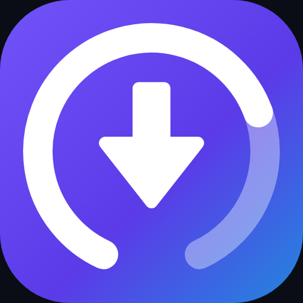

<p align="center">
  
</p>

# مُحمّل الفيديو — Video Downloader

تطبيق أندرويد شخصي لتحميل الوسائط من الروابط، مبني على **yt-dlp** و**ffmpeg** مضمّنين داخل
التطبيق. كل شيء يجري على الجهاز: لا خوادم، لا حسابات، لا تتبّع.

> تطبيق للاستخدام الشخصي — غير موجّه للنشر على Google Play.

---

## ما الذي يفعله

- لصق رابط (أو استقباله عبر **المشاركة** من أي تطبيق) ثم تحليله وعرض الصورة المصغّرة والعنوان
  والمدة واسم القناة.
- قائمة جودات مبنية من الصيغ الحقيقية التي أعادها yt-dlp — لا قائمة ثابتة — مع الحجم التقريبي
  لكل خيار.
- تحميل الفيديو بأي جودة متاحة، أو استخراج **MP3** بجودة 192 kbps مع صورة الغلاف والبيانات
  الوصفية.
- التحميل داخل **Foreground Service** مع إشعار يعرض النسبة والسرعة وزر إلغاء، وإشعار عند
  الاكتمال يفتح الملف.
- الحفظ في `Download/VideoDownloader/` عبر MediaStore، فيظهر الملف فورًا في تطبيق الملفات
  والمعرض.
- سجل التحميلات (Room) مع فتح/حذف.
- **تحديث ذاتي لمحرّك yt-dlp** أسبوعيًا وعند الطلب — وهذا ما يبقي التطبيق حيًا عندما تغيّر
  المواقع بنيتها.
- عربي أولًا مع RTL كامل، وإنجليزية، وثيم فاتح/داكن + ألوان الجهاز (Material You).

## لقطات من المنطق المهم

| المشكلة | الحل في الكود |
|---|---|
| YouTube يقدّم الجودات فوق 720p كمسارين منفصلين | `-f bestvideo[...]+bestaudio` + `--merge-output-format mp4` ليدمجهما ffmpeg، وإلا فالنتيجة فيديو صامت |
| MediaStore على Android 10+ يعمل بـ `Uri` لا بمسارات | التحميل إلى `cacheDir` ثم النقل عبر `contentResolver.openOutputStream` |
| إلغاء التحليل أثناء تهيئة المحرّك كان يترك ملف yt-dlp ناقصًا | التهيئة تعمل في `CoroutineScope` خاص، والمستدعون ينتظرونها فقط ([`YtDlpEngine`](app/src/main/java/com/mh/videodownloader/data/engine/YtDlpEngine.kt)) |
| التحديث يستبدل ملف yt-dlp بينما عملية تحميل تستخدمه | `Semaphore`: كل تشغيل يأخذ تصريحًا واحدًا، والتحديث يأخذها كلها |
| ملف محرّك تالف يبقى تالفًا للأبد | `repairingIfBroken` يعيد استخراج الملف من المورد ويعيد المحاولة مرة واحدة |
| الأرقام اللاتينية تنقلب داخل سطر عربي | `ltr()` يغلّفها بـ bidi isolate فتبقى `~28.5 MB` لا `MB 28.5~` |

## المعمارية

```text
UI (Compose)        HomeScreen · HistoryScreen · SettingsScreen
ViewModel           HomeViewModel · HistoryViewModel · SettingsViewModel
Domain              SourceDetector · FormatSelector · Models
Data                MediaRepository · DownloadQueue · MediaStoreSaver · Room · DataStore
Infra               DownloadService (Foreground) · YtDlpEngine · youtubedl-android
```

`SourceDetector` طبقة **عرض** لا استخراج: yt-dlp هو من يفهم المواقع. دورها إظهار اسم المصدر،
ورفض الروابط غير الصالحة مبكرًا، وتمرير أي رابط صالح آخر إلى المحرّك على أي حال.

## التقنيات

| الطبقة | الاختيار |
|---|---|
| المحرّك | `io.github.junkfood02.youtubedl-android` 0.18.1 (yt-dlp + ffmpeg + Python مضمّنة) |
| اللغة/الواجهة | Kotlin 2.2.21 · Jetpack Compose · Material 3 (BOM 2026.02.01) |
| البناء | AGP 8.13.2 · Gradle 8.14.5 · JDK 17 target |
| SDK | `compileSdk` / `targetSdk` = **36** (أندرويد 16)، `minSdk` = 26 |
| التخزين | Room 2.7 للسجل · DataStore للإعدادات · MediaStore للملفات |
| الخط | Cairo (متغيّر) — يرسم العربية واللاتينية بنفس الصوت |

## البناء

يتطلب Android SDK 36 وJDK 17+ (JDK المرفق مع Android Studio يكفي).

```bash
./gradlew :app:assembleDebug
```

APK للتثبيت الشخصي (موقّع، مُصغّر بـ R8):

```bash
./gradlew :app:assembleRelease
```

المخرجات في `app/build/outputs/apk/release/`:

| الملف | الحجم | الاستخدام |
|---|---|---|
| `app-arm64-v8a-release.apk` | ~56 MB | كل الأجهزة الحديثة — **هذا ما تثبّته** |
| `app-x86_64-release.apk` | ~59 MB | المحاكي |
| `app-universal-release.apk` | ~110 MB | الاثنان معًا |

الحجم الكبير طبيعي: Python وffmpeg مضمّنان داخل APK.

### التوقيع

ملف المفاتيح غير مرفوع إلى المستودع. أنشئ واحدًا مرة واحدة داخل `app/`:

```bash
keytool -genkeypair -v -keystore app/personal-release.jks -alias videodl -keyalg RSA -keysize 2048 -validity 10000 -storepass videodl -keypass videodl -dname "CN=Personal, O=Personal, C=SA"
```

يلتقطه `build.gradle.kts` تلقائيًا إن وُجد؛ وإن لم يوجد فسيخرج APK غير موقّع.

### التثبيت

```bash
adb install -r app/build/outputs/apk/release/app-arm64-v8a-release.apk
```

## ملاحظات تشغيلية

- **أول تشغيل** يستغرق ~10 ثوانٍ لفك ضغط Python وffmpeg؛ يظهر شريط "تهيئة المحرّك" أثناءها.
- **"Sign in to confirm you're not a bot"** من YouTube: اضغط "تحديث المحرّك وإعادة المحاولة"
  أولًا (يحل أغلب الحالات)، وإن استمر فاستورد ملف cookies من الإعدادات → متقدم.
- **إنستغرام** يحجب كثيرًا من الروابط بدون تسجيل دخول؛ ملف cookies هو الحل، واعتبره "أفضل جهد".
- الأحجام المعروضة **تقريبية**: تُحسب من `filesize` حين يوفّره الموقع، وإلا من متوسط البتريت.

## الهوية البصرية



الشعار سهم تحميل داخل **حلقة تقدّم**: القوس المضيء هو الجزء المكتمل والباهت هو المتبقّي، والفتحة
في الأسفل هي المخرج الذي ينزل منه السهم. يقول الشعار "جارٍ التحميل" لا "للأسفل" فحسب، ويبقى
مقروءًا حتى 24 بكسل.

الألوان: بنفسجي `#7C5CFF` ← `#5B3BE8` ← سماوي `#00B4D8` بتدرّج قطري. الخط Cairo.

<br clear="left">

| الملف | الاستخدام |
|---|---|
| [`ic_launcher_foreground.xml`](app/src/main/res/drawable/ic_launcher_foreground.xml) | العلامة الكاملة داخل الأيقونة المتكيّفة (adaptive icon) |
| [`ic_launcher_monochrome.xml`](app/src/main/res/drawable/ic_launcher_monochrome.xml) | طبقة الأيقونات المُلوّنة بالنظام (Android 13+) |
| [`ic_brand_glyph.xml`](app/src/main/res/drawable/ic_brand_glyph.xml) | نسخة مبسّطة (سهم + قاعدة) للاستخدام الصغير داخل التطبيق |
| [`docs/icon-512.png`](docs/icon-512.png) · [`docs/banner.png`](docs/banner.png) | أصول جاهزة للعرض والمشاركة |

## الترخيص والاستخدام

للاستخدام الشخصي فقط. تحميل المحتوى قد يخالف شروط استخدام المواقع؛ القرار وتبعاته على المستخدم.
لا تضف مشاركة الملفات ولا تجاوز المحتوى المدفوع.

وثيقة المتطلبات والتصميم الأصلية: [`video-downloader-android-spec.md`](video-downloader-android-spec.md).
