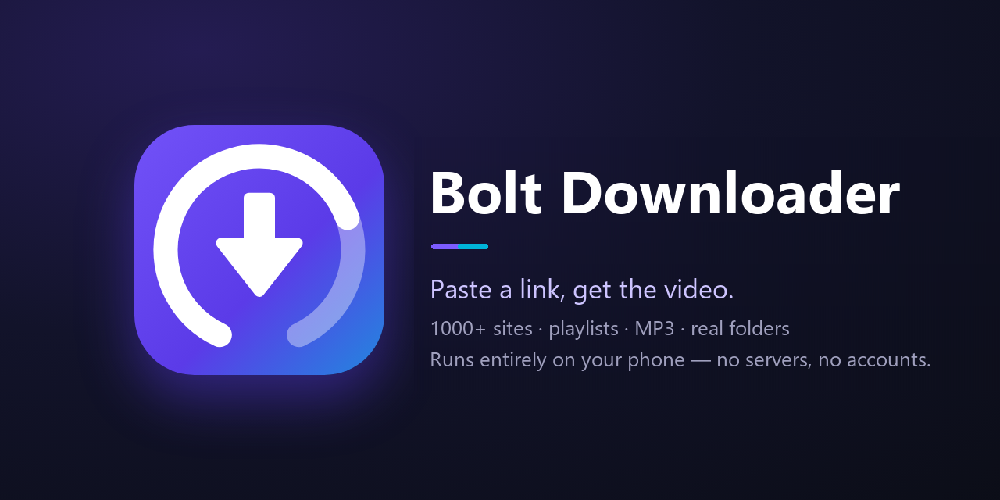
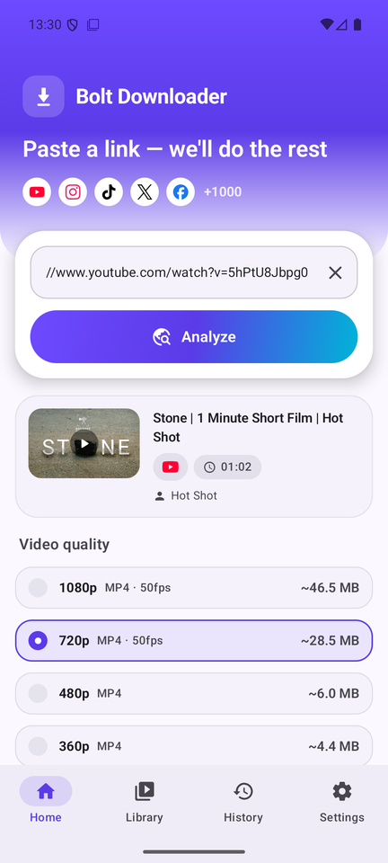
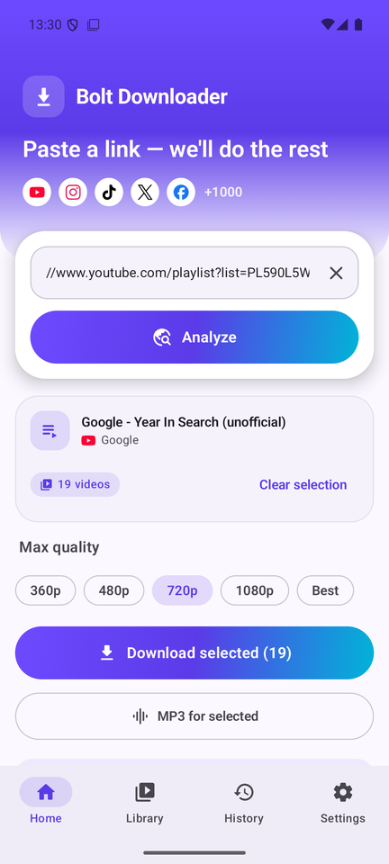
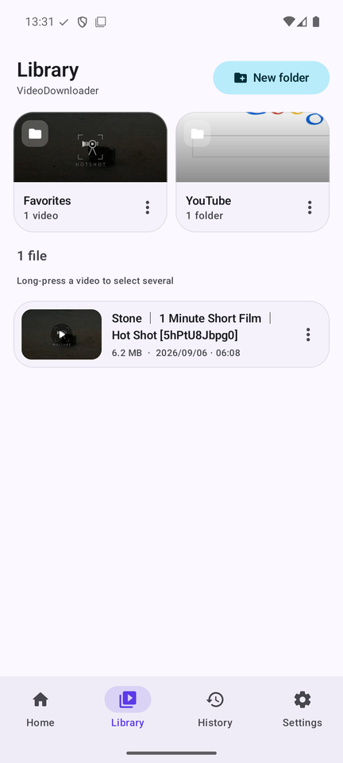
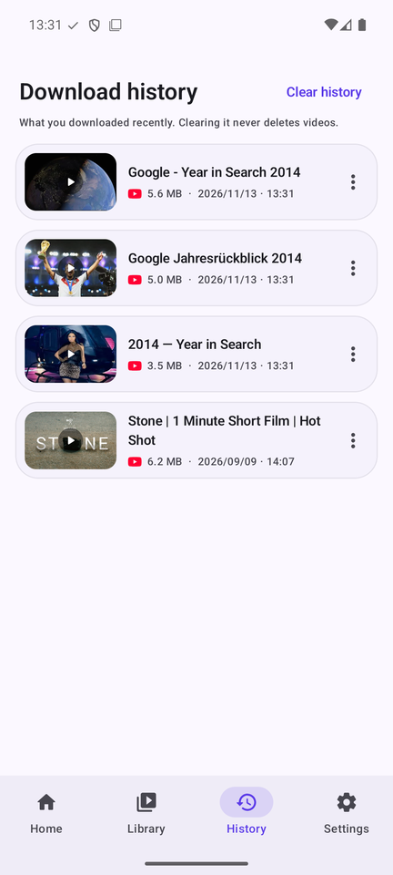
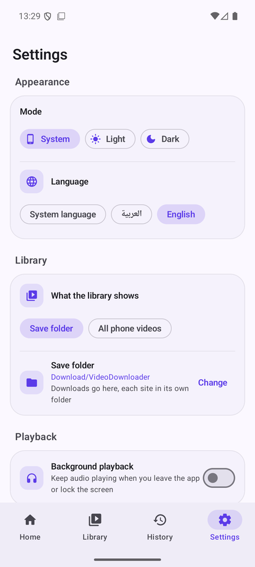
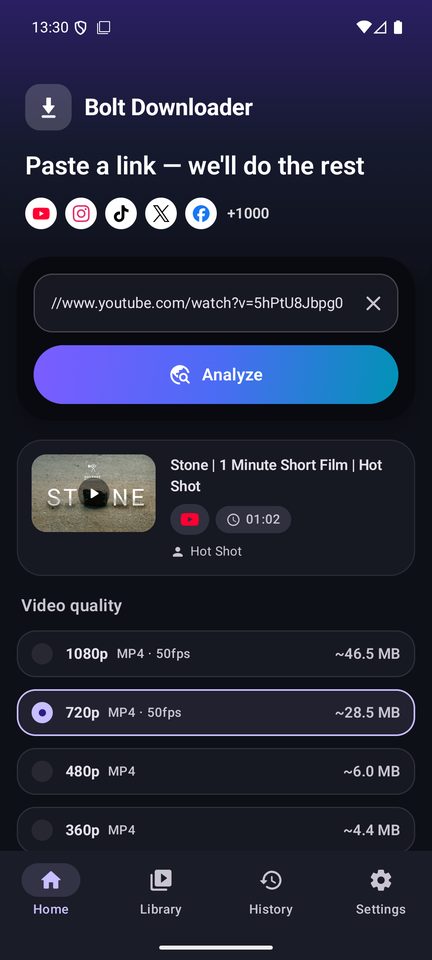

<p align="center">
  
</p>

<p align="center">
  <b>Paste a link, get the video.</b><br>
  A fast, private Android downloader for YouTube, TikTok, Instagram, X and 1000+ other sites.<br>
  Everything runs on your phone — no servers, no accounts, no tracking.
</p>

<p align="center">
  <a href="https://github.com/DrM7md/Bolt-Downloader/releases/latest"></a>
  
  
  <a href="LICENSE"></a>
</p>

<p align="center">
  <a href="https://github.com/DrM7md/Bolt-Downloader/releases/latest/download/Bolt-Downloader-arm64.apk"><b>⬇ Download the APK</b></a>
  &nbsp;·&nbsp; <a href="#-install">Install guide</a>
  &nbsp;·&nbsp; <a href="#-بالعربي">بالعربي</a>
</p>

---

## 📱 Screenshots

| Home | Playlists | Library | History | Settings | Dark |
|:---:|:---:|:---:|:---:|:---:|:---:|
|  |  |  |  |  |  |

## ✨ Features

**Downloading**
- **One-tap paste** — the big paste button reads the link and analyzes it immediately. Or just *Share* a link to Bolt from any app.
- **Real quality list** built from the formats the site actually offers — up to 1080p and 4K — each with its approximate size.
- **MP3 extraction** at 192 kbps with cover art and metadata.
- **Whole playlists** — pick the videos you want, set one max quality (or MP3) for all of them.
- **Background downloads** in a foreground service, with progress, speed and cancel in the notification.

**Organized for you**
- Every site gets its own folder, created on first use: `YouTube/`, `TikTok/`, `Instagram/`, …
- Playlists land in their own subfolder: `YouTube/<playlist name>/`.
- Saves to `Download/VideoDownloader/` by default — or any folder you choose.

**A library that is your real folders**
- What you see is exactly what's on disk — the same files your file manager shows.
- Create, rename and delete folders; move any video or folder anywhere — from the ⋮ menu or by **multi-selecting and dragging** onto a folder.
- Optional mode that shows **every video on the phone** (videos only, no audio clutter).
- **Info sheet** for any file: path, size, date, duration, resolution, type and the original link.

**History, player & upkeep**
- History of recent downloads. Clearing it never deletes a file, and it still finds videos you've moved.
- Built-in player (Media3) with optional background playback.
- **Self-updating engine** — yt-dlp updates itself weekly, so the app keeps working when sites change.

**Feels right**
- Arabic-first with full RTL, plus English. Light and dark themes. System font.
- Small and quick: R8-shrunk, thumbnails cached at display size.

## 📥 Install

1. Download an APK from the [latest release](https://github.com/DrM7md/Bolt-Downloader/releases/latest):
   - **`Bolt-Downloader-arm64.apk`** — for almost every phone from the last ~8 years. *Pick this one.*
   - `Bolt-Downloader-universal.apk` — works everywhere (bigger), if the first one won't install.
2. Open it on your phone and allow *Install unknown apps* for your browser or file manager when asked.
3. First launch takes ~10 seconds while the engine unpacks — only once.

> Bolt isn't on Google Play: Play doesn't allow apps that download from YouTube.

## 🔒 Privacy

No accounts, no analytics, no ads, no servers of ours. Links are processed by yt-dlp **on your device**; the only network traffic is to the site you're downloading from and to GitHub for the weekly engine update.

## 🛠 Build from source

Requirements: Android Studio (JDK 17+), Android SDK 36.

```bash
git clone https://github.com/DrM7md/Bolt-Downloader.git
cd Bolt-Downloader
./gradlew assembleDebug
```

For a signed release build, create `keystore.properties` in the project root (it's git-ignored):

```properties
storeFile=app/your-release.jks
storePassword=…
keyAlias=…
keyPassword=…
```

then run `./gradlew assembleRelease`. Without that file the release build is produced unsigned.

| Layer | Choice |
|---|---|
| Engine | [youtubedl-android](https://github.com/JunkFood02/youtubedl-android) — yt-dlp + ffmpeg + Python, bundled |
| UI | Kotlin 2.2 · Jetpack Compose · Material 3 |
| SDK | `compileSdk`/`targetSdk` 36 (Android 16), `minSdk` 26 (Android 8.0) |
| Storage | Room (history) · DataStore (settings) · Storage Access Framework (real folders) · MediaStore |
| Media | Media3 / ExoPlayer · Coil 3 |

## 🙏 Credits

Bolt stands on the shoulders of [yt-dlp](https://github.com/yt-dlp/yt-dlp), [FFmpeg](https://ffmpeg.org) and [youtubedl-android](https://github.com/JunkFood02/youtubedl-android).

## ⚖️ Disclaimer

Bolt Downloader is a tool for personal use. You are responsible for what you download: respect copyright and the terms of service of the sites you use, and only download content you have the right to. This project is not affiliated with YouTube, Google, TikTok, Instagram, Meta, X or any other site.

## 📄 License

[GPL-3.0](LICENSE) — the same license as the youtubedl-android engine it's built on.

---

## 🇸🇦 بالعربي

**Bolt Downloader** تطبيق أندرويد لتحميل الفيديو والصوت من يوتيوب وتيك توك وإنستقرام وإكس وأكثر من 1000 موقع. يعمل كل شيء على جوالك: لا خوادم ولا حسابات ولا تتبع.

**أهم المميزات**
- زر لصق واحد يلصق الرابط ويحلله فورا، أو شارك الرابط من أي تطبيق.
- قائمة جودات حقيقية حتى 1080p و4K مع حجم كل جودة، واستخراج MP3 بصورة الغلاف.
- تحميل قوائم التشغيل كاملة أو المقاطع التي تختارها منها.
- مجلد لكل موقع يُنشأ تلقائيا (`YouTube/` و`TikTok/`…)، وقائمة التشغيل في مجلد باسمها.
- مكتبة هي مجلداتك الحقيقية: إنشاء وإعادة تسمية وحذف ونقل، بالقائمة أو بتحديد عدة مقاطع وسحبها.
- وضع لعرض كل فيديوهات الجوال، وصفحة معلومات لكل مقطع.
- سجل لما حملته، ومسحه لا يحذف أي ملف.
- مشغل داخلي مع التشغيل في الخلفية، والمحرك يحدث نفسه كل أسبوع.
- عربي أولا مع دعم كامل للكتابة من اليمين، وإنجليزي، وثيم فاتح وداكن.

**التثبيت:** حمل `Bolt-Downloader-arm64.apk` من [آخر إصدار](https://github.com/DrM7md/Bolt-Downloader/releases/latest)، افتحه على جوالك واسمح بتثبيت التطبيقات من مصادر غير معروفة. أول تشغيل يأخذ نحو 10 ثوان لمرة واحدة فقط.

**تنبيه:** التطبيق للاستخدام الشخصي، وأنت مسؤول عما تحمله. احترم حقوق المحتوى وشروط المواقع.
